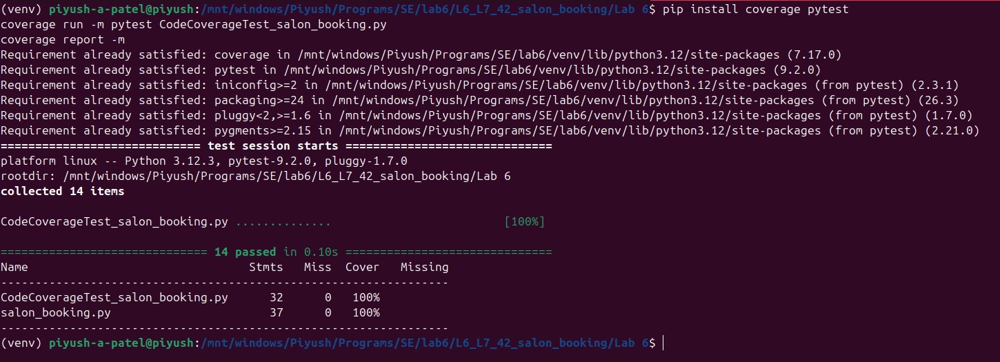
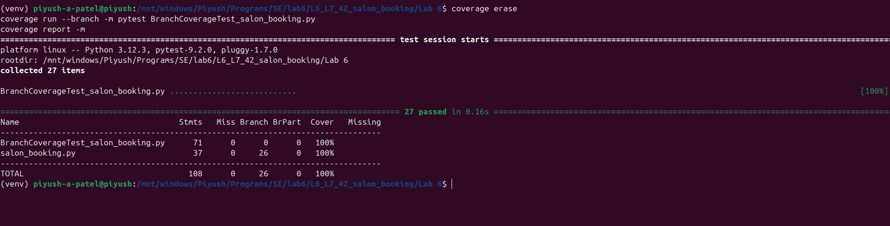

# L6_L7_42 — Salon Booking

Lab 6: Code and Branch Coverage

## About

A small Python module that works out extra-time charges by service, stylist level and membership, checks whether a booking can be made and reports client arrival status.

## Files

| File | Description |
|------|-------------|
| `salon_booking.py` | The module under test |
| `test_salon_booking.py` | Starter test file |
| `CodeCoverageTest_salon_booking.py` | Tests written for line (code) coverage |
| `BranchCoverageTest_salon_booking.py` | Tests written for branch coverage |
| `code_coverage.png` | Terminal screenshot of the code coverage run |
| `branch_coverage.png` | Terminal screenshot of the branch coverage run |
| `Lab6_Coverage_Report_PES2UG24CS350.pdf` | Report with both screenshots and observations |

## How to run

```
pip install coverage pytest
coverage run -m pytest CodeCoverageTest_salon_booking.py
coverage report -m
coverage erase
coverage run --branch -m pytest BranchCoverageTest_salon_booking.py
coverage report -m
```

## Results

| Run | Tests | Result |
|-----|-------|--------|
| Code coverage | 14 passed | 100% of statements in `salon_booking.py` |
| Branch coverage | 27 passed | 100% of statements and 26 of 26 branches in `salon_booking.py` |

## Screenshots

### Code coverage



### Branch coverage



## Author

| | |
|---|---|
| **Name** | Piyush A Patel |
| **SRN** | PES2UG24CS350 |
| **Section** | F |
| **Date** | 28 October 2026 |
