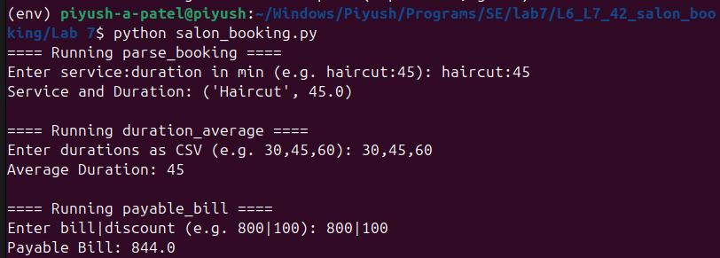
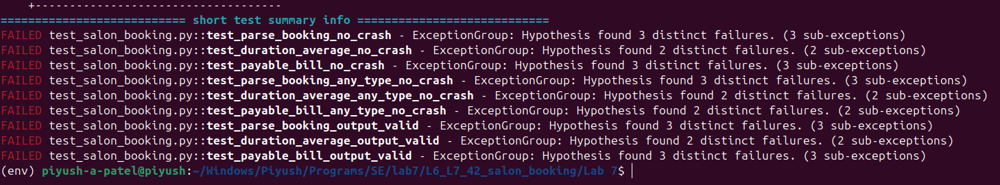
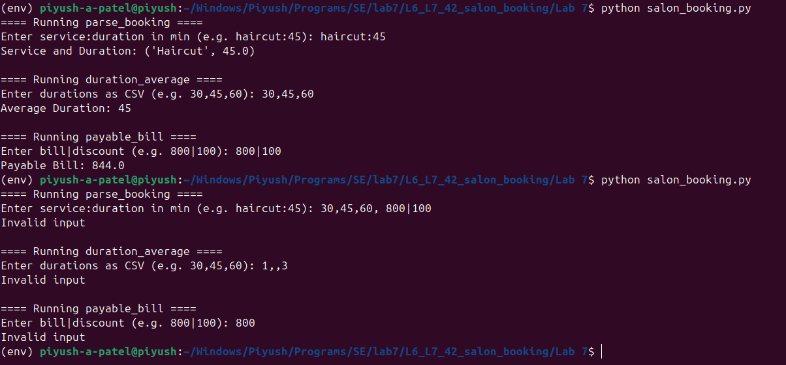
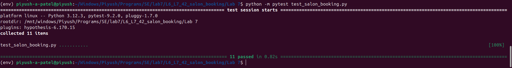

# L6_L7_42 — Salon Booking

Lab 7: Fuzz Testing

## About

A small Python module that parses salon bookings, averages service durations and works out the payable bill after a discount. Hypothesis was used to fuzz its three functions, find the inputs that crash them and harden the code against those inputs.

## Files

| File | Description |
|------|-------------|
| `salon_booking.py` | The fixed module, now validating its input |
| `test_salon_booking.py` | Hypothesis tests for `parse_booking`, `duration_average` and `payable_bill` |
| `Lab7_FuzzTesting_Report_PES2UG24CS350.pdf` | Report with the four screenshots and observations |
| `screenshots/` | Terminal screenshots of the runs before and after the fix |

## Bugs found

| Function | Problems in the original |
|----------|--------------------------|
| `parse_booking` | Crashed on `None`, a missing or extra `:`, and non-numeric minutes. Accepted an empty service name, `nan`, `inf` and negative minutes. |
| `duration_average` | Crashed on `None`, empty items such as `1,,3`, and non-numeric items. Accepted negative durations. |
| `payable_bill` | Crashed on `None`, a missing or extra `\|`, and non-numeric parts. Accepted `nan`, `inf` and negative values, and could overflow to `inf`. |

## The fix

Each function now checks that the input is a string, checks its structure, parses numbers inside `try/except`, and checks that results are finite and non-negative. Invalid input returns `None`, and `main()` prints `Invalid input` instead of raising an exception.

## How to run

```
pip install hypothesis pytest
python salon_booking.py
python -m pytest test_salon_booking.py
```

## Results

| Run | Tests | Result |
|-----|-------|--------|
| Original script | 11 | 9 failed, 2 passed |
| Fixed script | 11 | 11 passed |

## Screenshots

### Original script



### Tests on the original script



### Fixed script



### Tests on the fixed script



## Author

| | |
|---|---|
| **Name** | Piyush A Patel |
| **SRN** | PES2UG24CS350 |
| **Section** | F |
| **Date** | 11 November 2026 |
